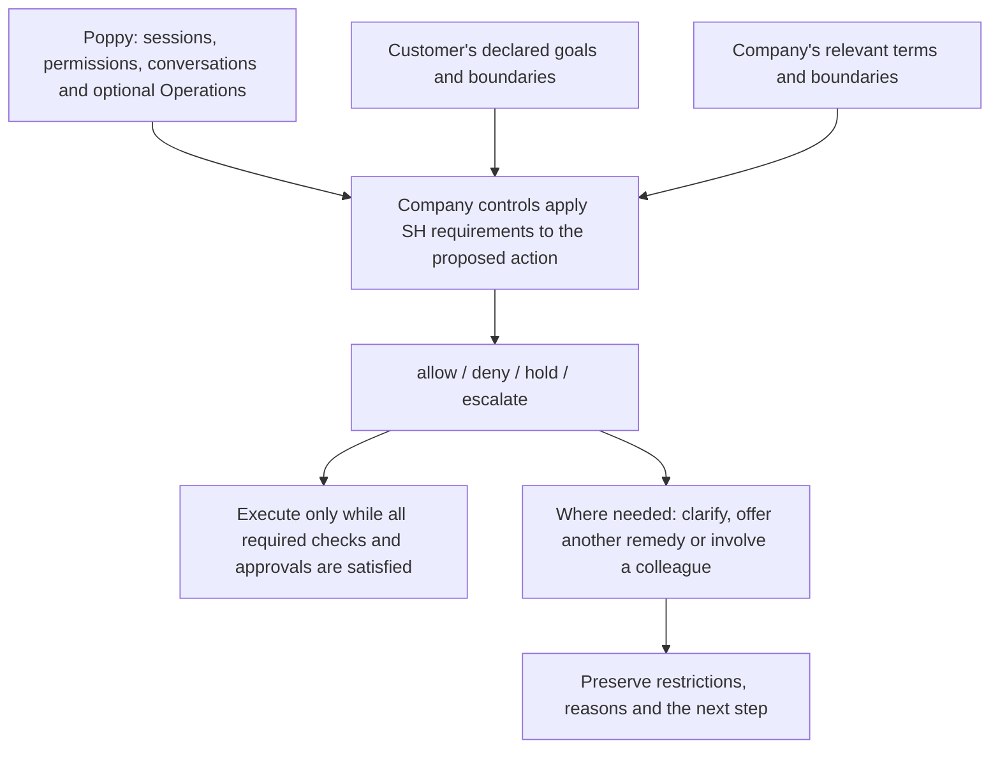

# Service Handshake extension proposal for the Personal Agent Protocol (Poppy)

When a customer sends an AI agent to a company, the company still needs to know what the customer wants, what the agent may agree to and when someone needs to help. This proposal applies the Service Handshake to those decisions within the Personal Agent Protocol, known as Poppy. It sets out how both parties' boundaries, unresolved authority and necessary safeguards can remain visible through an action or a handover.

**Independent proposal for review. Not adopted or endorsed by Poppy's authors; not yet demonstrated through a live integration.**

Maria McCann / Neos Wave first published the Service Handshake in March 2026. This proposal applies the later SH-1.2 framework to Poppy; it does not claim that the Poppy extension or all SH-1.2 features existed in March.

## What this means in practice

Priya has recognised access to help with her mother's bills. She asks her agent about cancelling the broadband, but the provider has not established her authority to cancel. The provider can explain the proposed terms while holding the cancellation, identify the approval or evidence needed, and preserve that restriction if a colleague takes over. It keeps other permitted help available.

If Priya relays a concern that an essential alarm may depend on the line, the provider treats that concern as raised and applies the relevant support response. The concern is a report to address, not a diagnosis.

## How the pieces fit



Illustrative relationship, not a deployed system or a mandatory sequence of separate products. Poppy already includes permissions, action confirmation and human handoff. Support needs and safeguarding can arise throughout the case. The company implements and enforces the checks; the diagram and exchanged records do not enforce them.

## What the proposal adds

- A shared way to exchange the relevant SH-1.2 declarations from both parties.
- A limited summary of the company's decision: allow, deny, hold or escalate.
- Handover information preserving blocked actions, reasons and missing evidence.
- A way to relay a support concern while distinguishing a report from an established fact.
- A proposed confirmation guard requiring the company to refuse execution while a relevant restriction remains unresolved.

The full assessment, evidence and private policy remain with the company. This package does not disclose or require private Neos prompts, assessment methods, risk thresholds or operational test suites.

## Start reading

| Reader | Start here |
|---|---|
| Service or CX leader | [Worked scenarios](examples/README.md) and [relationship to SH and Poppy](MAPPING.md) |
| Protocol reviewer or implementer | [Specification](SPECIFICATION.md), [exchange schema](schema/sh-poppy-extension.schema.json) and [validation scope](VALIDATION.md) |
| Researcher or contributor | [Sources and publication dates](SOURCES.md) and [changes in this revision](CHANGELOG.md) |

## Scope and status

This draft covers native Poppy conversations and, optionally, Operations introduced in those conversations. Existing authentication, approvals and staff procedures may satisfy relevant SH requirements. An exchanged declaration or allowing summary is not a credential.

Optional service policy packs are a future application of the framework. A company could identify a pack it has adopted, its version and applicable variations. No pack or new policy-pack wire field is included in this draft. See [Specification §13](SPECIFICATION.md#13-optional-service-policy-packs-informative).

| Item | Value |
|---|---|
| Extension name | `dualcx.com/service-handshake` |
| Proposed major version | `"1"` |
| Wire draft revision | `2026-10-11` |
| Package revision | Review draft 2, 12 October 2026 |
| Protocol baseline | Personal Agent Protocol Draft 0.1, updated 9 October 2026 |
| Service framework | [Published SH-1.2](https://zenodo.org/records/23181969) |
| Author / publisher | Maria McCann / Neos Wave Ltd, Dual CX |
| Licence | Apache 2.0; see LICENSE, NOTICE and SOURCES.md |

This package revision changes explanation and review guidance, not the exchange schema or examples. Its wire draft identifier therefore remains unchanged. Both parties must currently match that identifier and the major version. At a stable release, exact draft-date matching is intended to be replaced by documented compatibility rules; the stable rules have not yet been defined and no compatibility with an unreviewed draft is implied.

The SH-1.2 reference schemas are unchanged copies from the local publication package; [SOURCES.md](SOURCES.md) records their provenance and checksums. The new exchanged assessment summary is separate from SH's full local assessment.

## Checks

```sh
python -m pip install -r requirements-test.txt
python -m unittest discover -s tests -v
```

These checks validate structure and example consistency. They do not run a Poppy server or demonstrate live authority verification or action blocking. [VALIDATION.md](VALIDATION.md) records what remains to test.

## Maintainer and feedback

Neos Wave maintains this independent draft, authored by Maria McCann. Submit suggested changes through the [extension repository](https://github.com/neos-wave/service-handshake-pap-extension), identifying the package revision, scenario and proposed correction. Do not include credentials, customer records or sensitive exploit details in public issues.

Priority review questions are the proposed confirmation guard, the information needed at handover, and assistance for agents that do not support this extension. Poppy's published rules do not expressly settle this draft's custom confirmation-error mechanism; discussion with its implementers is still needed.

The parent framework and its existing releases remain in the [Service Handshake repository](https://github.com/neos-wave/service-handshake). This separate repository contains the independent protocol extension proposal.
